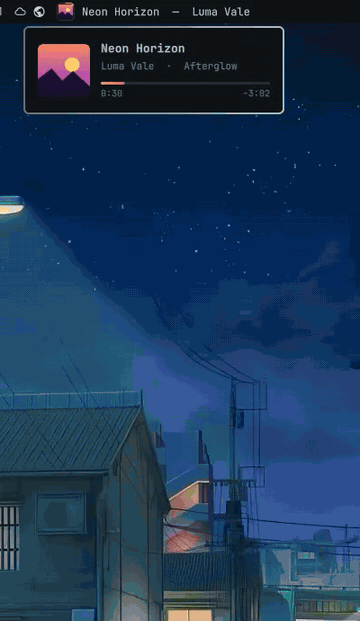
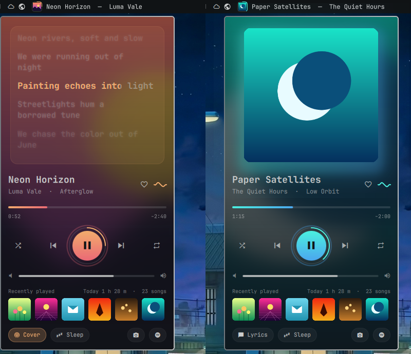

# Spotify Pulse

An animated Spotify player for the [Omarchy](https://omarchy.org) bar.

**Song — Artist** lives in your bar. Click it for a player card that takes on the colors of whatever's playing.

<p align="center">
  
</p>

## Features

**In the bar**
- `Song — Artist` with a little wave that flows to the music (see [Visualizer](#visualizer))
- On track change the title slides out and back in, and the new cover peeks in for a few seconds
- A ring around the wave fills as the song plays (and briefly shows the volume when you scroll)
- Long titles scroll back and forth smoothly (only while playing)
- Optional: the line being sung instead of the title (`barLyrics`)
- A moon shows while a sleep timer is set
- **Left click** opens the card, **middle click** plays/pauses, **right click** skips, **scroll** sets Spotify's volume
- Hides itself when Spotify isn't running

**In the card**
- **Cover-first design:** a big album cover glowing in its own colors, over a blurred copy of itself that tints the whole card. Or make it a spinning record (`coverStyle vinyl`).
- **Two-color album theme:** two colors are taken from the cover; the glow, seek bar, play button and equalizer blend between them, and everything fades smoothly between tracks.
- **Motion that means something:**
  - The cover crossfades on track change.
  - The cover sinks back when paused and springs forward on play.
  - The glow breathes with the bass when the visualizer runs.
  - The play button pulses while music plays and morphs between ⏯ states.
  - Controls cascade in when the card opens.
- **Lyrics on the back of the cover:**
  - Hit **Lyrics** (or double-click the cover) and the cover flips over.
  - **Karaoke sweep:** the current line fills with the accent color as it's sung.
  - The lines around it blur and fade with distance, like a camera's depth of field.
  - Click any line to jump to it. Timing off? `[` and `]` nudge it by half a second.
  - No synced lyrics? You still get the plain lyrics to scroll through.
  - Lyrics come from [lrclib.net](https://lrclib.net) and are opt-in (see Privacy).
- **Recently played:** the last tracks as small covers. Hover for the name, click to play it again.
- **Sleep timer:** pause after 15, 30 or 60 minutes, or when the song ends.
- Long titles scroll in the card too, instead of being cut off.
- Thin seek and volume sliders that grow when you hover them, and work with drag or scroll.
- Shuffle and repeat (off → all → one), with an accent dot when on.
- Honors Omarchy's reduced-motion setting: looping animations stop and transitions become instant.

**Keyboard** (with the card open)

| Key | Action | Key | Action |
|---|---|---|---|
| `Space` | Play / pause | `N` / `P` | Next / previous |
| `←` / `→` | Seek 5 s | `0`–`9` | Jump to 0 %–90 % |
| `↑` / `↓` | Volume | `S` / `R` | Shuffle / repeat |
| `L` | Lyrics | `[` / `]` | Lyrics sooner / later |
| `Z` | Sleep timer | `Esc` | Close |

<p align="center">
  
</p>

**In sync with Spotify.** It talks to the desktop app over MPRIS, the standard Linux media-control interface, so changes from the app, media keys, your phone (Spotify Connect) or the card all show up everywhere. No Spotify account, login or API key.

**Light on resources.** One shared service does the work for every monitor's bar. Looping animations only run while music plays, the playhead only updates fast while the card is open (or lyrics play in the bar), each cover is fetched once for color sampling, and lyrics are only fetched when you ask for them.

## Install

**Requirements**
- Omarchy 4, which provides the Quickshell-based `omarchy-shell`.
- The Spotify desktop app.
- `curl`, used once per track to cache the album cover for color sampling. It ships with every Omarchy install.
- Optional: [`cava`](https://github.com/karlstav/cava) for the real audio visualizer (`omarchy pkg add cava`).
- No accounts, API keys, root access or extra services.

```bash
omarchy plugin add https://github.com/iammhador/omarchy-spotify-pulse.git --enable
```

It lands in the center of the bar. To move it:

```bash
omarchy bar move io.github.iammhador.spotify-pulse --section center --index 3
```

Replacing another Spotify widget? Disable that one: `omarchy plugin disable <its id>`.

**Updating**

```bash
omarchy plugin update io.github.iammhador.spotify-pulse
omarchy restart shell   # the shell keeps the old version loaded until it restarts
```

## Visualizer

With `cava` installed, the bar's wave and the card's equalizer follow the real audio levels and the cover's glow breathes with the bass. cava only runs while music plays and is stopped the moment you pause. Without cava (or with `visualizer` off) they fall back to a gentle animation.

cava listens to your system's audio output, so it reacts to whatever is playing, not only Spotify. Nothing is recorded or leaves your machine.

## Settings

All optional. Change them in Omarchy's bar settings, or with `omarchy bar set`, e.g.:

```bash
omarchy bar set io.github.iammhador.spotify-pulse coverStyle vinyl
omarchy bar set io.github.iammhador.spotify-pulse barLyrics true
```

| Setting          | Default    | What it does                                                        |
|------------------|------------|---------------------------------------------------------------------|
| `maxWidth`       | `260`      | Max width of the bar text, in px, before it scrolls                 |
| `showArtist`     | `true`     | Show `— Artist` after the song name                                 |
| `marquee`        | `true`     | Scroll long titles (otherwise cut off with `…`)                     |
| `scrollAction`   | `"volume"` | Mouse wheel on the bar: `"volume"`, `"track"` or `"none"`           |
| `pillCover`      | `"peek"`   | Cover in the bar: `"peek"` (on track change), `"always"` or `"off"` |
| `pillProgress`   | `true`     | Progress ring around the bar's wave                                 |
| `barLyrics`      | `false`    | Show the line being sung in the bar (fetches lyrics, see Privacy)   |
| `showWhenClosed` | `false`    | Show a dim "Open Spotify" button when Spotify isn't running         |
| `albumColors`    | `true`     | Theme the card from the album cover                                 |
| `blurBackdrop`   | `true`     | Blurred cover tinting the whole card                                |
| `coverStyle`     | `"square"` | `"square"` cover or `"vinyl"` spinning record                       |
| `karaoke`        | `true`     | Fill the current lyric line as it's sung                            |
| `visualizer`     | `true`     | Real audio levels when `cava` is installed                          |
| `history`        | `true`     | Remember and show recently played tracks                            |

## Scripting

```bash
omarchy-shell spotify-pulse toggle        # open / close the card
omarchy-shell spotify-pulse playPause
omarchy-shell spotify-pulse next
omarchy-shell spotify-pulse previous
omarchy-shell spotify-pulse shuffle
omarchy-shell spotify-pulse repeat
omarchy-shell spotify-pulse volume 60     # percent
omarchy-shell spotify-pulse lyrics        # toggle lyrics
omarchy-shell spotify-pulse sleep 30      # pause in 30 min; -1 = when the song ends, 0 = off
omarchy-shell spotify-pulse clearHistory
omarchy-shell spotify-pulse status        # JSON: track, position, lyrics, visualizer, sleep…
```

## Uninstall

```bash
omarchy plugin remove io.github.iammhador.spotify-pulse
rm -rf ~/.cache/spotify-pulse ~/.local/state/spotify-pulse   # optional: cached covers, history
```

If you disabled another Spotify widget for this one, turn it back on with `omarchy plugin enable <its id>`.

## Privacy

- **Album colors:** each cover is downloaded once from Spotify's image CDN into `~/.cache/spotify-pulse/` (pruned after 7 days) so its colors can be sampled locally.
- **Lyrics:** only when you turn Lyrics on, or enable `barLyrics`, the song's title, artist, album and length are sent to [lrclib.net](https://lrclib.net) to look up lyrics.
- **Recently played:** the last 24 tracks (title, artist, album, cover link and Spotify link) are kept in `~/.local/state/spotify-pulse/history.json`, on your machine only. Turn it off with `history false`, or wipe it with `clearHistory`.
- **Visualizer:** cava reads audio levels locally; nothing is recorded or sent anywhere.

## Limitations

MPRIS can't like songs, browse playlists or show the queue. Those need Spotify's Web API and a login, which this plugin deliberately avoids. Recently played is the next best thing: it's remembered locally.

## Credits

Spotify player detection is adapted from [Spotify Mini](https://github.com/LainsMain/omarchy-spotify-mini) by LainsMain (MIT). The demo uses made-up tracks and generated covers.

## License

[MIT](LICENSE)
