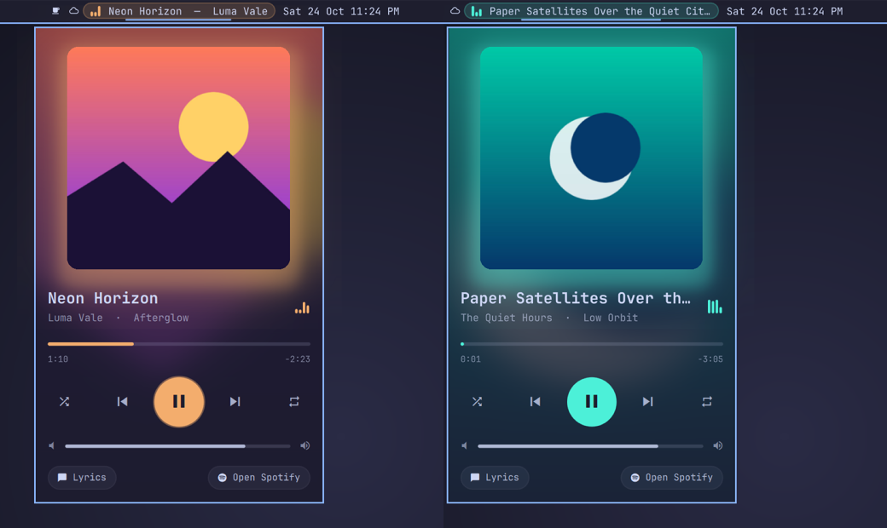

# Spotify Pulse

An animated Spotify player for the [Omarchy](https://omarchy.org) bar.

**Song — Artist** lives in your bar. Click it for a player card that takes on the colors of whatever's playing.

<p align="center">
  
</p>

## Features

**In the bar**
- `Song — Artist` with a live equalizer that only moves while music plays
- The title slides out and back in on track change
- Long titles scroll back and forth smoothly (only while playing)
- **Left click** opens the card, **middle click** plays/pauses, **right click** skips, **scroll** sets Spotify's volume
- Hides itself when Spotify isn't running

**In the card**
- **Cover-first design:** a big album cover glowing in its own color, over a blurred copy of itself that tints the whole card
- **Album-color theme:** the accent, glow, seek bar and play button take their color from the cover, and fade smoothly between tracks
- **Motion that means something:**
  - The cover crossfades on track change.
  - The cover sinks back when paused and springs forward on play.
  - The play button pulses while music plays and morphs between ⏯ states.
  - Controls cascade in when the card opens.
- **Synced lyrics on the back of the cover:**
  - Hit **Lyrics** (or double-click the cover) and the cover flips over.
  - The current line is big and bright, and the lines around it fade away toward the edges.
  - Click any line to jump to it.
  - Lyrics come from [lrclib.net](https://lrclib.net) and are opt-in (see Privacy).
- Thin seek and volume sliders that grow when you hover them, and work with drag or scroll
- Shuffle and repeat (off → all → one), with an accent dot when on
- Keyboard shortcuts: `Space` play/pause · `←/→` seek · `↑/↓` volume · `N/P` next/previous · `S` shuffle · `R` repeat · `L` lyrics · `Esc` close

<p align="center">
  
</p>

**In sync with Spotify.** It talks to the desktop app over MPRIS, the standard Linux media-control interface, so changes from the app, media keys, your phone (Spotify Connect) or the card all show up everywhere. No Spotify account, login or API key.

**Light on resources.** Nothing ticks while the card is closed, and the bar only animates while music plays. Each cover is fetched once for color sampling, and lyrics are only fetched when you turn them on.

## Install

Requires Omarchy 4 (the Quickshell-based `omarchy-shell`) and the Spotify desktop app.

```bash
omarchy plugin add https://github.com/iammhador/omarchy-spotify-pulse.git --enable
```

It lands in the center of the bar. To move it:

```bash
omarchy bar move io.github.iammhador.spotify-pulse --section center --index 3
```

Replacing another Spotify widget? Disable that one: `omarchy plugin disable <its id>`.

## Settings

All optional. Set them with `omarchy bar set`, e.g.:

```bash
omarchy bar set io.github.iammhador.spotify-pulse maxWidth 320
omarchy bar set io.github.iammhador.spotify-pulse scrollAction track
```

| Setting          | Default    | What it does                                                  |
|------------------|------------|---------------------------------------------------------------|
| `maxWidth`       | `260`      | Max width of the bar text, in px, before it scrolls          |
| `showArtist`     | `true`     | Show `— Artist` after the song name                           |
| `marquee`        | `true`     | Scroll long titles (otherwise cut off with `…`)               |
| `scrollAction`   | `"volume"` | Mouse wheel on the bar: `"volume"`, `"track"` or `"none"`     |
| `albumColors`    | `true`     | Theme the card from the album cover                           |
| `blurBackdrop`   | `true`     | Blurred cover tinting the whole card                          |
| `showWhenClosed` | `false`    | Show a dim "Open Spotify" button when Spotify isn't running   |

## Scripting

```bash
omarchy-shell spotify-pulse toggle        # open / close the card
omarchy-shell spotify-pulse playPause
omarchy-shell spotify-pulse next
omarchy-shell spotify-pulse previous
omarchy-shell spotify-pulse shuffle
omarchy-shell spotify-pulse repeat
omarchy-shell spotify-pulse volume 60     # percent
omarchy-shell spotify-pulse lyrics        # toggle lyrics
omarchy-shell spotify-pulse status        # JSON: track, position, shuffle, loop, volume, accent…
```

## Privacy

- **Album colors:** each cover is downloaded once from Spotify's image CDN into `~/.cache/spotify-pulse/` (pruned after 7 days) so its colors can be sampled locally.
- **Lyrics:** only when you turn Lyrics on, the song's title, artist, album and length are sent to [lrclib.net](https://lrclib.net) to look up synced lyrics.

## Limitations

MPRIS can't like songs, browse playlists or show the queue. Those need Spotify's Web API and a login, which this plugin deliberately avoids.

## Credits

Spotify player detection is adapted from [Spotify Mini](https://github.com/LainsMain/omarchy-spotify-mini) by LainsMain (MIT). The demo uses made-up tracks and generated covers.

## License

[MIT](LICENSE)
